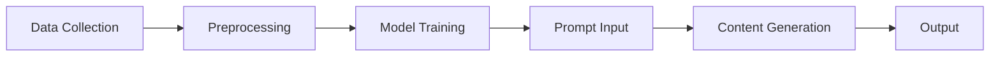
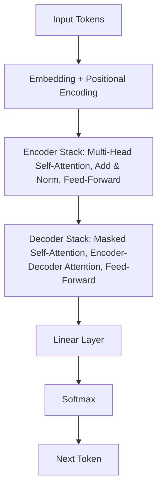
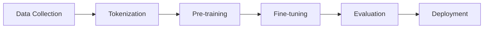

# Aim:	Comprehensive Report on the Fundamentals of Generative AI and Large Language Models (LLMs)

**NAME: Priyanka S**

**REG NO: 212224040255**

Experiment:
Develop a comprehensive report for the following exercises:
1.	Explain the foundational concepts of Generative AI. 
2.	Focusing on Generative AI architectures. (like transformers).
3.	Generative AI applications.
4.	Generative AI impact of scaling in LLMs.

# Algorithm: Step 1: Define Scope and Objectives
1.1 Identify the goal of the report (e.g., educational, research, tech overview)
1.2 Set the target audience level (e.g., students, professionals)
1.3 Draft a list of core topics to cover
Step 2: Create Report Skeleton/Structure
2.1 Title Page
2.2 Abstract or Executive Summary
2.3 Table of Contents
2.4 Introduction
2.5 Main Body Sections:
•	Introduction to AI and Machine Learning
•	What is Generative AI?
•	Types of Generative AI Models (e.g., GANs, VAEs, Diffusion Models)
•	Introduction to Large Language Models (LLMs)
•	Architecture of LLMs (e.g., Transformer, GPT, BERT)
•	Training Process and Data Requirements
•	Use Cases and Applications (Chatbots, Content Generation, etc.)
•	Limitations and Ethical Considerations
•	Future Trends
2.6 Conclusion
2.7 References
________________________________________
Step 3: Research and Data Collection
3.1 Gather recent academic papers, blog posts, and official docs (e.g., OpenAI, Google AI)
3.2 Extract definitions, explanations, diagrams, and examples
3.3 Cite all sources properly
________________________________________
Step 4: Content Development
4.1 Write each section in clear, simple language
4.2 Include diagrams, figures, and charts where needed
4.3 Highlight important terms and definitions
4.4 Use examples and real-world analogies for better understanding
________________________________________
Step 5: Visual and Technical Enhancement
5.1 Add tables, comparison charts (e.g., GPT-3 vs GPT-4)
5.2 Use tools like Canva, PowerPoint, or LaTeX for formatting
5.3 Add code snippets or pseudocode for LLM working (optional)
________________________________________
Step 6: Review and Edit
6.1 Proofread for grammar, spelling, and clarity
6.2 Ensure logical flow and consistency
6.3 Validate technical accuracy
6.4 Peer-review or use tools like Grammarly or ChatGPT for suggestions
________________________________________
Step 7: Finalize and Export
7.1 Format the report professionally
7.2 Export as PDF or desired format
7.3 Prepare a brief presentation if required (optional)

# Output
# Comparative Study of Generative AI Models: ChatGPT vs Claude

## Objective

To compare the behaviour of different Generative AI models using identical prompts and to evaluate their performance based on **accuracy, creativity, hallucination, reasoning, speed, and engineering usefulness**.

## AI Tools Selected

| # | Tool | Developer |
|---|------|-----------|
| 1 | ChatGPT | OpenAI |
| 2 | Claude | Anthropic |

---

# 1. Foundational Concepts of Generative AI

**Prompt:** *"Explain the fundamental concepts of Generative AI, including its working principles, types, advantages, limitations, and real-world applications. Differentiate Generative AI from traditional AI with suitable examples."*

## ChatGPT

### 1.1 What is Generative AI?
Generative AI is a branch of Artificial Intelligence that **creates new content**: text, images, audio, video, and code. It learns patterns from large datasets using Machine Learning and Deep Learning, then produces new outputs that resemble the training data without copying it.

**Popular examples:** ChatGPT (text), DALL·E (images), GitHub Copilot (code), Suno (music).

### 1.2 Working Principle

1. **Data Collection** – gather text, images, audio, or video at large scale.
2. **Preprocessing** – clean, filter, and convert data into a trainable format.
3. **Training** – a neural network learns statistical patterns in the data.
4. **Prompt** – the user gives an instruction.
5. **Generation** – the model predicts the output step by step.
6. **Output** – text, image, audio, video, or code is returned.

### 1.3 Types of Generative AI Models
| Type | Key Idea | Typical Use |
|------|----------|-------------|
| GAN | Generator vs Discriminator compete | Face and image synthesis |
| VAE | Encode to latent space, then decode | Image reconstruction, anomaly detection |
| Transformer | Self-attention over tokens | Chatbots, translation, code |
| Diffusion | Learn to remove noise step by step | Image and video generation |

### 1.4 Advantages
- Boosts productivity by automating repetitive work
- Supports creativity and idea generation
- Reduces content-creation cost and time
- Enables personalized learning
- Speeds up software development
- Generates synthetic data for training other models

### 1.5 Limitations
- **Hallucination:** confident but wrong output
- **Bias** inherited from training data
- High computational and energy cost
- Copyright and ownership questions
- Privacy and security risks
- Misuse (deepfakes, misinformation)

### 1.6 Real-World Applications
| Domain | Use |
|--------|-----|
| Education | Notes, quizzes, concept explanation |
| Software | Code generation, debugging, documentation |
| Engineering | Design ideas, CAD assistance, reports |
| Business | Marketing copy, reports, customer chat |
| Healthcare | Summarizing records, drug discovery support |
| Entertainment | Music, art, scripts, game assets |

### 1.7 Generative AI vs Traditional AI
| Aspect | Traditional AI | Generative AI |
|--------|----------------|---------------|
| Goal | Analyze, classify, predict | Create new content |
| Output | Label, score, decision | Text, image, audio, code |
| Models | Decision Tree, SVM, Logistic Regression | GAN, VAE, Transformer, Diffusion |
| Data need | Smaller, labelled datasets | Very large, mostly unlabelled datasets |
| Example | Spam filter | Writing a new email with ChatGPT |

> **In one line:** Traditional AI *recognizes*; Generative AI *creates*.

### 1.8 Conclusion
Generative AI is a major step in AI because it moves from analysing data to producing new content. It brings strong productivity and creativity benefits but needs careful handling of accuracy, bias, privacy, and cost.

**Quick Revision**
| Term | Meaning |
|------|---------|
| Prompt | Instruction given to the model |
| Token | Small unit of text the model processes |
| Hallucination | Plausible but false output |
| Latent space | Compressed internal representation of data |

---

## Claude

### The core idea
Generative AI refers to models that learn the *distribution* of their training data well enough to produce new samples from it. A traditional classifier learns a mapping from input to label, roughly P(label | input). A generative model learns something closer to P(data), or P(data | prompt), so it can be sampled to produce new data. That one shift explains most of the differences below.

### How it works
1. **Learn patterns.** During training the model is shown enormous amounts of data and repeatedly adjusts its internal weights to get better at a simple objective. For language models the objective is predicting the next token. For image diffusion models it is predicting the noise that was added to an image.
2. **Represent meaning.** Inputs are converted to vectors (embeddings), so similar concepts end up numerically close together.
3. **Sample outputs.** At generation time the model produces a probability distribution over possible next elements and samples from it. A setting called *temperature* controls how adventurous the sampling is. Low values give predictable output, high values give more varied output.
4. **Refine behaviour.** Modern assistants are further trained with human feedback so that outputs are helpful and safe, not just statistically likely.

Important point: the model is **not retrieving stored answers**. It is generating from learned statistics, which is why it can be creative and also why it can be wrong.

### Main families
| Family | Mechanism | Strength | Weakness |
|--------|-----------|----------|----------|
| GANs | Generator and discriminator trained adversarially | Sharp images, fast sampling | Unstable training, mode collapse |
| VAEs | Probabilistic encoder and decoder with a smooth latent space | Stable, good for interpolation | Often blurry outputs |
| Transformers | Self-attention over token sequences | Scales well, handles long context | Compute and memory heavy |
| Diffusion | Iterative denoising from pure noise | High quality and diversity | Slow multi-step sampling |

Output modality is a second way to categorize: text-to-text, text-to-image, text-to-audio, text-to-video, and code generation. Many current systems are **multimodal** and handle several of these at once.

### Advantages
- **Speed on first drafts:** emails, summaries, boilerplate code, test cases.
- **Lower barrier to skills:** someone who cannot program can prototype; someone learning can get patient, tailored explanations.
- **Exploration:** many design or wording alternatives can be seen quickly.
- **Synthetic data:** useful when real data is scarce or private.

### Limitations and risks
- **Hallucination.** Fluent text is not the same as true text. Facts, citations, and numbers need verification.
- **Bias.** Models reflect patterns, including unfair ones, in their data.
- **Cost.** Training and serving large models needs substantial hardware and energy.
- **Intellectual property.** Training-data licensing and ownership of outputs are unsettled legal areas.
- **Misuse.** Deepfakes, phishing, and automated misinformation.
- **Over-reliance.** Students and engineers can stop checking or understanding the work.

### Applications
- **Software engineering:** code completion, refactoring, test generation, debugging, documentation.
- **Education:** explanations at different levels, practice questions, feedback on drafts.
- **Healthcare and science:** protein structure and molecule design, summarizing literature, medical imagery for training.
- **Business:** support assistants, document analysis, localization.
- **Creative industries:** concept art, music, game assets, scriptwriting aids.

### Generative vs Traditional AI
| | Traditional (discriminative) AI | Generative AI |
|---|---|---|
| Learns | Boundary between classes or a prediction function | The data distribution itself |
| Question answered | "What is this?" / "What will happen?" | "What could exist?" |
| Output | Label, number, ranking | New text, image, audio, code |
| Evaluation | Clear metrics (accuracy, F1, RMSE) | Harder: quality is subjective and multi-dimensional |
| Example | Fraud detector flags a transaction | Model drafts a customer reply about the flagged transaction |
| Example | Image classifier says "cat" | Image model draws a cat in watercolor |

The two are complementary. Real systems often combine them, for example a generative model drafting responses while a classifier screens them for safety.

### Takeaway
Generative AI is best seen as a powerful pattern-based drafting and exploration tool. It is most valuable when a human stays in the loop to verify and decide.

---

# 2. Generative AI Architectures (Transformers)

**Prompt:** *"Explain the major Generative AI architectures, focusing on Transformer architecture, its components, and working principles. Describe how self-attention and encoder-decoder mechanisms help generate meaningful outputs."*

## ChatGPT

### 2.1 Introduction
Generative AI architectures learn patterns from data and generate new content. The four major ones are **GANs, VAEs, Transformers, and Diffusion Models**. The **Transformer**, introduced in *"Attention Is All You Need"* (Vaswani et al., 2017), is the base of most modern LLMs.

### 2.2 Overview of the Other Architectures
- **GAN:** Generator creates fake data; Discriminator judges real vs fake; both improve by competing.
- **VAE:** Encoder maps data to a latent distribution; Decoder reconstructs or generates data from samples.
- **Diffusion:** Forward process adds noise; reverse process removes it to generate content.

### 2.3 Transformer Structure

### 2.4 Components
| Component | Function |
|-----------|----------|
| Input Embedding | Converts tokens into numerical vectors |
| Positional Encoding | Adds word-order information |
| Self-Attention | Finds relationships between tokens |
| Multi-Head Attention | Several attention heads learn different relationships |
| Add & Layer Norm | Residual connection and stable training |
| Feed-Forward Network | Two linear layers with activation, applied to each token |
| Linear + Softmax | Turns the final vector into next-token probabilities |

### 2.5 Self-Attention
Each token produces a **Query (Q)**, **Key (K)**, and **Value (V)** vector.

$$\text{Attention}(Q,K,V)=\text{softmax}\left(\frac{QK^{T}}{\sqrt{d_k}}\right)V$$

- $QK^T$ measures how related each pair of tokens is.
- Dividing by $\sqrt{d_k}$ keeps values stable.
- Softmax converts scores to weights.
- Weights are applied to $V$ to get the context-aware output.

**Example:** In *"The student placed the book on the table because it was heavy"*, attention links **"it"** to **"book"**.

### 2.6 Encoder–Decoder Mechanism
**Encoder:** embeds tokens, adds positions, applies self-attention and feed-forward layers, and produces contextual representations.

**Decoder:** takes previously generated tokens, applies *masked* self-attention (cannot see future tokens), uses *encoder-decoder attention* to look at the input, then predicts the next token. This repeats until the sequence ends.

**Example:** Input "How are you?" → Output (Tamil) "நீங்கள் எப்படி இருக்கிறீர்கள்?"

### 2.7 Applications
Chatbots, translation, summarization, code generation, question answering, content generation, multimodal systems.

### 2.8 Conclusion
Self-attention gives the model context; the encoder-decoder structure converts input into meaningful output. This combination makes Transformers the leading architecture in Generative AI.

**Quick Revision**
| Part | Remember |
|------|----------|
| Q, K, V | Query, Key, Value |
| Masked attention | Blocks future tokens |
| Positional encoding | Gives order information |
| Softmax | Scores → probabilities |

---

## Claude

### Landscape of architectures
Four families dominate generative modelling, and they differ in *how* they represent the data distribution:

- **GANs** learn implicitly through a minimax game (generator vs discriminator).
- **VAEs** learn an explicit probabilistic latent-variable model, trained by maximizing a lower bound (ELBO) that balances reconstruction quality and a regularized latent space.
- **Diffusion models** learn to reverse a gradual noising process, in effect learning the gradient of the data distribution.
- **Autoregressive Transformers** factor the distribution as a product of next-token probabilities, $P(x)=\prod_t P(x_t \mid x_{<t})$.

Transformers are also used *inside* other families: many modern diffusion models use a transformer as the denoising network.

### Why Transformers replaced RNNs
Recurrent networks read tokens one at a time, which prevents parallel training and makes information from early tokens fade over long sequences. The Transformer instead lets **every token attend directly to every other token** in a single step. That gives (1) parallelism across the sequence on GPUs, and (2) short paths between distant words, which helps long-range dependencies.

### Building blocks
1. **Tokenization and embeddings.** Text becomes token IDs, then learned vectors.
2. **Positional information.** Attention itself is order-blind, so position is injected via sinusoidal encodings, learned embeddings, or (in many recent models) rotary embeddings.
3. **Self-attention.** Each token forms a query, key, and value through learned linear projections:

$$\text{Attention}(Q,K,V)=\text{softmax}\!\left(\frac{QK^{\top}}{\sqrt{d_k}}+M\right)V$$

   Here $M$ is a mask. In decoders it sets future positions to $-\infty$ so token $t$ only sees tokens $\le t$.
4. **Multi-head attention.** The model runs several attention operations in parallel in smaller subspaces. Different heads often specialize (for example syntax, coreference, or positional patterns), although the roles are not always cleanly interpretable.
5. **Feed-forward network.** A per-token two-layer MLP that holds much of the model's stored knowledge and accounts for a large share of the parameters.
6. **Residual connections and layer normalization.** These keep gradients flowing in deep stacks and stabilize training.
7. **Output head.** A linear layer plus softmax gives a probability over the vocabulary.

### Intuition for self-attention
For the sentence *"The trophy didn't fit in the suitcase because it was too big"*, resolving "it" needs the model to compare "it" against earlier nouns. The query for "it" scores highly against the key for "trophy", so the value from "trophy" contributes strongly to the new representation of "it". Stacked layers repeat this, building progressively richer context.

### Encoder, decoder, and encoder-decoder models
| Variant | Attention type | Strength | Examples |
|---------|----------------|----------|----------|
| Encoder-only | Bidirectional | Understanding, classification, embeddings | BERT |
| Decoder-only | Causal (masked) | Open-ended generation | GPT family, Llama, Claude |
| Encoder-decoder | Bidirectional encoder + causal decoder with **cross-attention** | Translation, summarization | Original Transformer, T5 |

In the encoder-decoder design, **cross-attention** lets each decoder step query the encoder's output, so every generated word can focus on the relevant part of the source. In decoder-only models, the prompt and the generated text sit in one sequence, and causal self-attention does the same job.

### How generation proceeds
1. Tokenize the prompt and run it through all layers (the "prefill").
2. Take the final position's output and compute probabilities over the vocabulary.
3. Select a token (greedy, top-k, top-p, or temperature sampling).
4. Append it and repeat. A **KV cache** stores past keys and values so earlier work is not recomputed.

### Practical caveats
- Attention cost grows **quadratically** with sequence length, which motivates efficient attention methods such as FlashAttention, sliding windows, and sparse variants.
- Fluent output is produced token by token and is not verified for truth, so factual errors can still appear.

### Summary
Self-attention supplies context-sensitive representations; the encoder-decoder (or decoder-only) arrangement determines how input is turned into output. Together with embeddings, residual connections, and feed-forward layers, they form the architecture behind modern LLMs.

---

# 3. Generative AI Architectures and Applications

**Prompt:** *"Discuss different Generative AI architectures such as GANs, VAEs, Transformers, and Diffusion Models. Explain their working principles and applications in software development, education, entertainment, and engineering."*

## ChatGPT

### 3.1 GANs
**Working:** Generator takes random noise and makes fake data. Discriminator compares fake with real. Both are trained repeatedly until the generator output looks real.

| Domain | Application |
|--------|-------------|
| Software | Synthetic test data, data augmentation |
| Education | Realistic visuals for learning material |
| Entertainment | Face generation, animation, digital art |
| Engineering | Design variants, image enhancement, industrial inspection data |

### 3.2 VAEs
**Working:** Encoder → latent distribution → sample → Decoder. Training minimizes reconstruction error plus a regularization term.

| Domain | Application |
|--------|-------------|
| Software | Anomaly detection, synthetic data |
| Education | Customized visual materials |
| Entertainment | Character and design variations |
| Engineering | Defect detection, design exploration |

### 3.3 Transformers
**Working:** Tokenize → embed → add positions → self-attention → feed-forward → predict next token → repeat.

| Domain | Application |
|--------|-------------|
| Software | Code generation, debugging, documentation |
| Education | Tutoring, quiz creation, summaries |
| Entertainment | Stories, scripts, subtitles, dialogue |
| Engineering | Technical reports, design descriptions |

### 3.4 Diffusion Models
**Working:** Forward process adds noise; the model learns to predict that noise; generation starts from random noise and removes it step by step.

| Domain | Application |
|--------|-------------|
| Software | Synthetic images for vision testing, UI mockups |
| Education | Scientific illustrations and diagrams |
| Entertainment | Artwork, animation frames, video |
| Engineering | Concept visualization, visual inspection data |

### 3.5 Comparison
| Architecture | Core Idea | Strength | Weakness |
|--------------|-----------|----------|----------|
| GAN | Two competing networks | Sharp images | Unstable training |
| VAE | Latent distribution | Stable, smooth latent space | Blurry outputs |
| Transformer | Self-attention | Text and code, scalable | High compute |
| Diffusion | Iterative denoising | High quality | Slow generation |

### 3.6 Advantages
Creativity, automation, productivity, synthetic data, personalization, design exploration.

### 3.7 Limitations
High compute, data dependency, hallucination, bias, training complexity, misuse for fake content.

### 3.8 Conclusion
Each architecture has a different working principle and strength. Together they power applications in software development, education, entertainment, and engineering.

**Quick Revision**
| Architecture | Memory Hook |
|--------------|-------------|
| GAN | Generator + Discriminator |
| VAE | Encoder + Latent + Decoder |
| Transformer | Attention + next token |
| Diffusion | Add noise, then remove noise |

---

## Claude

### Choosing an architecture is choosing trade-offs
No single architecture is best. The right one depends on the data type, the quality needed, the sampling speed, and how much training stability matters.

| Architecture | How it generates | Sampling speed | Training stability | Typical output quality |
|---|---|---|---|---|
| GAN | One forward pass of generator | Very fast | Difficult | Sharp, but can lack diversity |
| VAE | Sample latent, decode once | Fast | Stable | Smooth, often blurry |
| Transformer (autoregressive) | One token at a time | Moderate (sequential) | Stable at scale | Excellent for discrete sequences |
| Diffusion | Many denoising steps | Slow (improving with distillation) | Stable | State-of-the-art images, audio, video |

### Working principles in brief
- **GAN:** Generator $G$ and discriminator $D$ play $\min_G \max_D$ of a value function. Equilibrium is reached when $G$'s samples are indistinguishable from real ones. Failure modes: mode collapse and vanishing gradients.
- **VAE:** The encoder outputs mean and variance of a Gaussian; a sample is drawn using the reparameterization trick so gradients can pass through; the decoder reconstructs. The loss is reconstruction error plus KL divergence to a prior.
- **Transformer:** Models sequences using attention and predicts the next token; scaling data and parameters improves quality predictably.
- **Diffusion:** A fixed forward process gradually corrupts data; a network is trained to predict the noise at each step; generation runs the reverse chain. Latent diffusion (as in Stable Diffusion) performs this in a compressed latent space for efficiency.

### Applications by sector

**Software development**
- *Transformers:* code completion, test generation, code review, translation between languages, natural-language-to-SQL, agentic coding tools that read a repository and make multi-file edits.
- *GANs/VAEs:* synthetic test data and anomaly detection in logs or telemetry.
- *Diffusion:* generating UI mockups and placeholder assets.

**Education**
- *Transformers:* adaptive tutors, worked solutions with explanations, rubric-based feedback, language practice partners.
- *Diffusion:* custom diagrams and illustrations.
- *VAEs/GANs:* privacy-preserving synthetic student datasets for research.

**Entertainment**
- *Diffusion:* concept art, textures, storyboards, and increasingly video and music generation.
- *GANs:* face and style transfer, upscaling and restoration of old footage.
- *Transformers:* scriptwriting aids, dynamic NPC dialogue, interactive fiction.

**Engineering**
- *VAEs and diffusion:* generative design, such as proposing lightweight geometries under load constraints; molecule and materials candidate generation.
- *Transformers:* summarizing standards and datasheets, drafting specifications, assisting in simulation scripting.
- *GANs:* surrogate data for defect-detection models where real defects are rare.

### Cautions for engineers
1. Generated designs and code must be **validated** by simulation, tests, and review.
2. Check **licensing and provenance** of training data and outputs.
3. Evaluate **bias and safety** for the specific deployment, not just the general benchmark.

### Conclusion
Transformers dominate language and code, diffusion leads in perceptual media, GANs persist where speed matters, and VAEs remain useful for compact latent representations. Hybrid systems that combine them are increasingly common.

---

# 4. Impact of Scaling in LLMs

**Prompt:** *"Explain the impact of scaling in Large Language Models (LLMs) by increasing model parameters, training data, and computational resources. Discuss its effects on performance, reasoning, accuracy, and computational cost."*

## ChatGPT

### 4.1 Introduction
**Scaling** means increasing three things to improve an LLM:
1. **Model parameters** (weights and biases)
2. **Training data** (amount and quality)
3. **Computational resources** (GPUs, TPUs, memory, networking)

### 4.2 Effect of Each Factor
| Factor | Positive Impact | Challenge |
|--------|-----------------|-----------|
| Parameters | Learns complex patterns, handles harder tasks | More memory needed |
| Training data | Wider knowledge, better generalization | Quality and availability |
| Compute | Larger models, faster training at scale | Hardware and electricity cost |

### 4.3 Scaling Laws
Research shows performance improves **predictably** when parameters, data, and compute increase together in a balanced way. Increasing only one factor gives smaller benefits. Data quality and architecture also matter.

### 4.4 Effects of Scaling
**Performance:** More detailed responses, better multitask ability, better generalization. *Example:* a small model writes a basic Python program, a larger one adds explanation and error handling.

**Reasoning:** Better math, logic, multi-step problem-solving, and debugging. But larger models can still make logical mistakes.

**Accuracy:** Better context understanding and relevance. But hallucination, bad data, and outdated information still limit accuracy.

### 4.5 Computational Cost
| Cost Type | Description |
|-----------|-------------|
| Hardware | High-end GPUs and clusters |
| Training | Long run time and electricity |
| Memory | Storing weights and activations |
| Storage | Large datasets and checkpoints |
| Inference | Running the model for every user request |
| Maintenance | Continuous infrastructure support |

### 4.6 Advantages and Disadvantages
| Advantages | Disadvantages |
|------------|---------------|
| Better understanding | High cost |
| Stronger reasoning | High energy use |
| Handles complex tasks | More memory and storage |
| Better content quality | Harder deployment |
| Works across many applications | Bias risk from large datasets |

### 4.7 Conclusion
Scaling improves performance, reasoning, and accuracy, but also increases cost. Success needs a **balance** between model size, data quality, and compute.

**Exam Point:** Scaling = more parameters + more data + more compute, balanced for efficiency.

---

## Claude

### What "scaling" really means
Scaling is the empirical observation that **test loss falls as a smooth power law** when parameters ($N$), training tokens ($D$), and compute ($C$) increase. Kaplan et al. (2020) first characterized this; Hoffmann et al. (2022, the "Chinchilla" paper) showed that for a fixed compute budget, many large models had been **under-trained** and that parameters and tokens should grow roughly in proportion. A commonly cited rule of thumb is about 20 training tokens per parameter for compute-optimal training.

$$L(N,D) \approx E + \frac{A}{N^{\alpha}} + \frac{B}{D^{\beta}}$$

where $E$ is irreducible loss and $A, B, \alpha, \beta$ are fitted constants.

### Effects of each axis
- **Parameters** increase capacity: more facts stored, more nuanced representations.
- **Data** supplies the experience; with too little data, extra parameters over-fit or sit idle.
- **Compute** limits how far you can push both, and also allows more training steps and longer context.

### Effect on performance
Lower loss usually transfers to better results on a broad range of benchmarks. But the returns are **diminishing**: each constant improvement in loss needs a multiplicative increase in compute. Newer trends reflect this: heavily over-training smaller models (many more tokens per parameter than Chinchilla suggests) because inference cost over a model's lifetime often matters more than training cost.

### Effect on reasoning
- Some abilities, such as multi-step arithmetic or following abstract few-shot patterns, appear **to emerge** only past a certain scale. There is ongoing debate: some researchers argue that apparent sudden jumps are partly artifacts of discontinuous metrics, and that on smoother metrics improvement looks gradual.
- Scale helps, but **how** a model is used also matters. Post-training (instruction tuning, reinforcement learning) and *test-time compute* (letting a model produce longer reasoning before answering) have produced large reasoning gains that raw pre-training scale alone did not.

### Effect on accuracy
Bigger and better-trained models generally make fewer factual errors and are better calibrated, but they **still hallucinate**, particularly about rare facts or when asked about things outside their training data. Retrieval, tool use, and verification remain important.

### Effect on cost
| Cost | What drives it |
|------|----------------|
| Training | Approximately $6ND$ floating-point operations for a dense transformer; thousands of accelerators for weeks or months |
| Inference | Memory for weights and the KV cache, plus per-token compute; scales with every user query |
| Energy and environment | Power draw of data centers, cooling, hardware manufacturing |
| Engineering | Distributed training, fault tolerance, data pipelines |

**Mitigation techniques:** Mixture-of-Experts (only some parameters active per token), quantization, distillation to smaller models, speculative decoding, and efficient attention.

### Limits and open questions
- **Data wall:** high-quality human text is finite; synthetic data and multimodal data are being explored.
- **Benchmark saturation:** measuring further gains becomes harder.
- **Safety:** more capable models require more careful evaluation and alignment, not less.

### Conclusion
Scaling has been one of the most reliable drivers of LLM progress, but it is not the only one. Data quality, architecture, post-training, and inference-time methods now matter alongside raw size, and cost and energy make efficiency a first-class concern.

---

# 5. Large Language Models (LLMs) and How They Are Built

**Prompt:** *"Explain what Large Language Models (LLMs) are and how they are developed. Describe the stages of data collection, tokenization, pre-training, fine-tuning, evaluation, and deployment with suitable examples."*

## ChatGPT

### 5.1 What is an LLM?
A **Large Language Model** is a Transformer-based AI model trained on large amounts of text to understand and generate human-like language. Examples: ChatGPT (OpenAI), Gemini (Google), Llama (Meta), Claude (Anthropic).

### 5.2 Development Pipeline

### 5.3 Stage 1: Data Collection
Gather books, papers, websites, code, and news. Clean the data by removing duplicates, harmful, and low-quality content.
*Example:* An educational chatbot collects textbooks, lecture notes, and tutorials.

### 5.4 Stage 2: Tokenization
Text is split into tokens, and each token gets a numeric ID.
*Example:* "Generative AI is useful." → `Generative` | `AI` | `is` | `useful` | `.` (illustrative; real tokenizers differ).

### 5.5 Stage 3: Pre-training
The Transformer learns general language by **predicting the next token** (self-supervised). The loss is computed, then weights are updated by backpropagation.
*Example:* "AI is a branch of ____" → "computer science".

### 5.6 Stage 4: Fine-tuning
The pre-trained model is trained on a smaller task-specific dataset (question-answer or instruction-response pairs).
*Example:* Engineering textbooks → an engineering study assistant.

### 5.7 Stage 5: Evaluation
| Metric | Purpose |
|--------|---------|
| Accuracy | Correctness of task output |
| Perplexity | How well the model predicts text (lower is better) |
| BLEU | Translation similarity |
| ROUGE | Summary overlap |
| Human evaluation | Quality, clarity, usefulness |

*Example:* Test an educational chatbot on 100 technical questions.

### 5.8 Stage 6: Deployment
Host the model on cloud or servers, connect via API, add a user interface, and monitor performance.
*Example:* A college website chatbot for course and exam queries.

### 5.9 Summary Table
| Stage | Purpose | Example |
|-------|---------|---------|
| Data Collection | Gather data | Textbooks, websites |
| Tokenization | Text → numbers | Word pieces → IDs |
| Pre-training | General language | Next-token prediction |
| Fine-tuning | Specialize | Education assistant |
| Evaluation | Test quality | 100 test questions |
| Deployment | Release | College chatbot |

### 5.10 Conclusion
LLM development follows six stages from raw data to a working application. Each stage affects the quality and reliability of the final model.

**Exam Point:** Data Collection → Tokenization → Pre-training → Fine-Tuning → Evaluation → Deployment.

---

## Claude

### What an LLM is
An LLM is a neural network, almost always a Transformer with billions of parameters, trained on very large text corpora to model the probability of the next token. From this simple objective come broad abilities: answering questions, summarizing, translating, writing code, and following instructions.

### The development lifecycle in practice

**1. Data collection and curation**
Sources include filtered web crawls, books, scientific papers, code repositories, and licensed or synthetic data. Raw data is noisy, so the pipeline typically includes language identification, quality filtering, **deduplication** (which reduces memorization and improves efficiency), removal of personal information, and filtering of harmful content. Data *mix* (the ratio of code, math, web text, and so on) strongly influences the final model's strengths. Legal and ethical review of data sources is part of responsible development.

**2. Tokenization**
A tokenizer (commonly Byte-Pair Encoding) learns a vocabulary of frequent character sequences and converts text to integer IDs. A word like "unbelievable" may split into several subwords, while a common word stays one token. Tokenization affects cost (more tokens means more compute), multilingual fairness (some languages need more tokens per sentence), and how well the model handles numbers or rare words.

**3. Pre-training**
The model starts with random weights and trains on trillions of tokens to minimize next-token cross-entropy loss. It needs distributed training across many accelerators using data, tensor, and pipeline parallelism, along with careful learning-rate schedules, mixed-precision arithmetic, and frequent checkpoints. The result is a **base model**: highly knowledgeable but not yet a helpful assistant, as it simply continues text.

**4. Post-training: fine-tuning and alignment**
- **Supervised fine-tuning (SFT)** on instruction-response demonstrations teaches the format of helpful answers.
- **Preference optimization** (RLHF, DPO, or related methods) uses human or AI-generated preference judgments to make the model more helpful, honest, and harmless.
- **Parameter-efficient methods** such as LoRA adapt a model to a domain by training only a small number of added weights, which is practical for students and small teams.
- Reinforcement learning on verifiable tasks (math, code) is used to improve reasoning.

**5. Evaluation**
No single metric is enough. Typical layers:
- *Capability benchmarks:* MMLU (knowledge), GSM8K and MATH (math), HumanEval and SWE-style tasks (code).
- *Safety and robustness:* red-teaming, jailbreak tests, bias and toxicity audits.
- *Hallucination and factuality tests.*
- *Human and task-specific evaluation* with real user scenarios.
Care is needed about **benchmark contamination**, where test data leaked into training and inflated the scores.

**6. Deployment and serving**
Models are optimized with quantization, batching, KV-caching, and efficient serving engines to reduce latency and cost. They are exposed through APIs or embedded in applications, often combined with **retrieval-augmented generation (RAG)** for up-to-date or private knowledge and with tools for actions. Post-launch, teams monitor quality, safety incidents, latency, and cost, then iterate.

### End-to-end example: a college study assistant
1. Choose an open base model.
2. Collect licensed course notes, past questions, and textbooks (with permission).
3. Fine-tune with LoRA on question-answer pairs.
4. Evaluate on held-out exam questions and check for incorrect or unsafe answers.
5. Deploy behind a web interface with RAG over current syllabus documents, and log feedback for improvement.

### Conclusion
Building an LLM is an engineering pipeline in which data quality, scale, alignment, and evaluation all matter. Pre-training builds general knowledge; post-training shapes behaviour; evaluation and monitoring keep the system trustworthy.

---

# Comparison of ChatGPT and Claude Responses

| Criterion | ChatGPT | Claude |
|-----------|---------|--------|
| **Accuracy** | Accurate, stays at a standard textbook level | Accurate, adds nuance (e.g., debate on emergent abilities, Chinchilla rule) |
| **Creativity** | Template-like and exam-friendly | More explanatory, with analogies and practical examples |
| **Hallucination** | Low risk; content is conventional | Low risk; explicitly flags caveats and limitations |
| **Reasoning** | Step-by-step lists | Explains the "why" and trade-offs |
| **Speed / Length** | Compact, quickly scannable | Longer and denser |
| **Engineering usefulness** | Good for quick revision and exams | Good for design decisions and real projects |
| **Formatting** | Headings, tables, "Quick Revision" and exam points | Prose with focused tables, formulas, and cautions |

---

# Result

The experiment compared **ChatGPT** and **Claude** using identical prompts on Generative AI concepts, architectures, applications, LLM scaling, and LLM development. Both models produced relevant and technically correct responses, with differences in style and depth. ChatGPT gave concise, well-structured, revision-oriented answers that suit students preparing for exams. Claude gave more detailed explanations that included trade-offs, mathematical formulations, and limitations, which suit engineering design and deeper understanding. The experiment helped in understanding the capabilities, usefulness, and limitations of different Generative AI models, and showed that outputs from any model should be verified before use.

